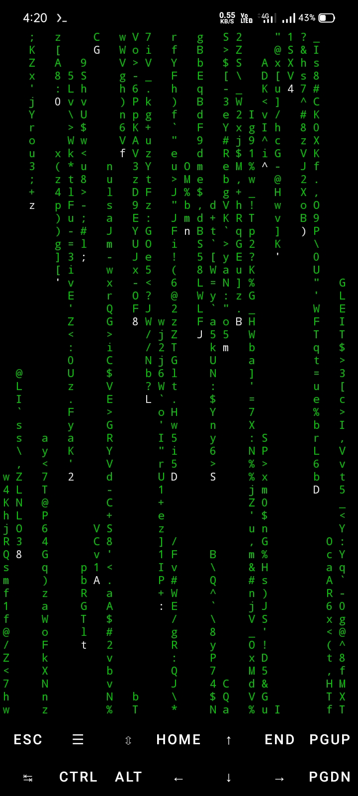
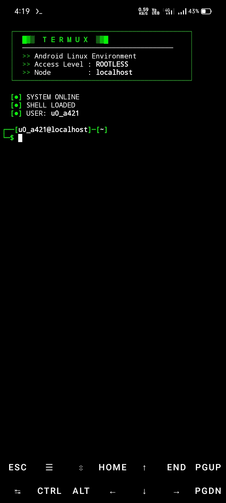

# 🟢 Termux Hacker Theme & Autosuggestions

A complete Kali Linux-style setup for Termux with Matrix rain, custom prompt, autosuggestions, and syntax highlighting.

### 📸 Preview

<div align="center">
  
  
</div>

## ✨ Features
- Matrix rain on startup (3.5s)
- Hacker-style ASCII banner
- Zsh autosuggestions (like Fish/Kali)
- Syntax highlighting (Blue commands, Cyan paths)
- Useful aliases (`cls`, `ll`, `..`, etc.)
- `Ctrl+R` fuzzy history search (fzf)
- Removes default Termux welcome message

## 🚀 Installation

Copy and paste this single command in Termux:

```bash
pkg install git -y && git clone https://github.com/souravpaul-ind/termux-hacker-theme.git && cd termux-hacker-theme && bash setup.sh
```

⌨️ Shortcuts
cls : Clear screen

ll : List files

.. : Go back

Ctrl + R : Search history

Right Arrow / Space : Accept autosuggestion
